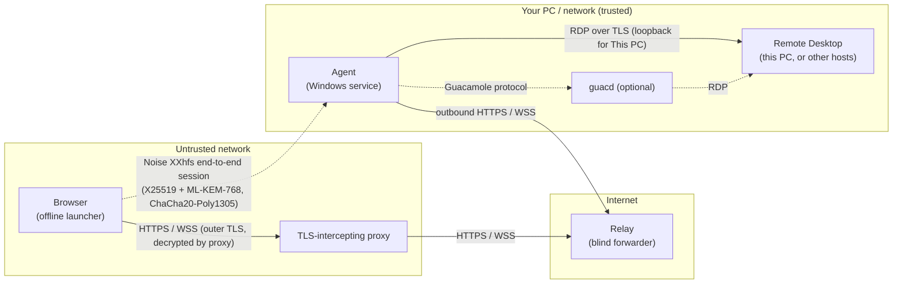

# WRHS design

WRHS gives you your remote desktop in a web browser from networks you do not
trust, including networks whose proxy decrypts all HTTPS. The outer layer is
ordinary HTTPS, so the proxy lets it through. Inside it is a second,
end-to-end encrypted layer between the browser and an agent on your own
network. The proxy can block that layer but cannot read it or change it
without being detected.

This document explains the architecture and the reasons behind each choice.
[THREAT_MODEL.md](THREAT_MODEL.md) lists what is and is not protected,
[PROTOCOL.md](PROTOCOL.md) is the wire specification, and
[DEPLOYMENT.md](DEPLOYMENT.md) is the operator guide.

## 1. Problem

Corporate networks, hotels, schools and some national networks run
TLS-intercepting proxies. The client device trusts the proxy's root CA,
because IT installed it or the user clicked through. The proxy then
terminates every HTTPS connection, inspects the plaintext and re-encrypts it
to the real server. Inside that tunnel it can:

- read everything: URLs, headers, bodies, WebSocket messages;
- keep it, for example DLP archives and logs ("record now, decrypt later");
- change anything, including the JavaScript of the pages you load;
- impersonate any server, because it can issue a trusted certificate for any
  name.

Normal web remote-desktop gateways (Apache Guacamole, RD Web Client, most
SaaS products) rely on that same TLS connection. Behind such a proxy, the
proxy sees your screen, your keystrokes and the passwords you type.

WRHS keeps those working through the proxy, but makes the proxy a blind
carrier.

> **Acceptable use.** WRHS protects confidentiality on networks you do not
> control. It does not hide that it is being used: there is no domain
> fronting and no protocol camouflage. If a network's owner forbids tunnels,
> follow their policy.

## 2. Goals and non-goals

| | Goal |
|---|---|
| G1 | Confidentiality and integrity of all session content (screen, input, clipboard, passwords, target names) against everything between the browser and the agent, including a proxy with a trusted CA. |
| G2 | Authenticate the agent without the Web PKI, which the proxy subverts. |
| G3 | Work through restrictive proxies: only HTTPS on 443, WebSocket optional, connections cut at random. |
| G4 | Forward secrecy, including against a future quantum computer decrypting archived traffic. |
| G5 | Zero-trust relay: the public rendezvous server never holds keys. The agent needs no inbound ports. |
| G6 | Nothing to install on the client: a standard browser is enough. |
| G7 | Leak as little metadata as practical: message sizes, keystroke timing. |

Non-goals:

- Hiding *that* WRHS is in use, or bypassing a network's blocking.
- Protecting a compromised client device. If the device runs malware, or
  the same organization that runs the proxy also manages the laptop and
  records its screen, no network protocol helps.
- Availability: whoever controls the network can always drop the traffic.

## 3. Architecture

| Component | Where it runs | Trusted with plaintext? | Role |
|---|---|---|---|
| Launcher | Client browser, opened from disk | Yes | UI, Noise initiator, RDP client (IronRDP, WebAssembly), Guacamole renderer |
| Proxy | Untrusted network | **No** | Sees only the outer layer |
| Relay | Any public host | **No** | Pairs browser and agent sessions, copies opaque frames |
| Agent | The PC to reach, or a machine on its network | Yes | Noise responder, user auth, policy, RDP gateway (RDCleanPath), bridge to guacd |
| RDP host | The same PC (loopback) or your network | Yes | Windows' own Remote Desktop service (or xrdp) |
| guacd | Next to the agent (optional) | Yes | Alternative engine: RDP client (FreeRDP) that turns the desktop into Guacamole drawing instructions |

### Two layers

- **Outer layer:** standard TLS from the browser to the relay, and from the
  agent to the relay. It gets the traffic through firewalls and proxies. It
  is assumed broken. The tests in this repository run the outer layer with
  no TLS at all and check that nothing leaks.
- **Inner layer:** a Noise session from the browser to the agent. The relay
  and the proxy only ever see Noise handshake messages and AEAD-sealed
  records.

### Why the inner layer ends at the agent, not the relay

The relay has to be reachable from anywhere, so it is the component most
likely to be attacked or run by someone else (a VPS provider, a
colleague). If the inner layer ended there, a relay compromise would expose
every session. With the agent as the endpoint, the relay is a dumb pipe
like the proxy. The agent dials out, so the private network needs no
inbound firewall rule. The agent-to-RDP leg stays inside the trusted
network (on the same PC, it is loopback), and RDP adds its own TLS/NLA on
that leg.

## 4. The hard part: trusting the code in the browser

End-to-end encryption in a web page has a well-known flaw. The encryption
code is itself delivered over the network. An active intercepting proxy can
serve a modified page that sends your password and keys to the proxy before
any encryption happens. Encrypting in JavaScript served through the proxy
therefore protects only against a *passive* proxy.

So the root of trust has to reach the browser some other way. WRHS supports
three delivery modes and recommends the first:

| Mode | Root of trust | Protects against | Status |
|---|---|---|---|
| **Offline launcher** (recommended) | A single self-contained HTML file, generated by `wrhs-agent launcher`, copied to the device over a trusted channel, opened from disk | Passive *and* active proxies | Implemented |
| Browser extension | Code signed by the browser's extension store | Passive and active proxies | Roadmap (same bundle) |
| Hosted page | Served by the relay over the intercepted channel | Passive inspection only; UI shows a warning | Implemented, off by default |

The offline launcher:

- **Self-contained.** All code (client, crypto, the official
  guacamole-common-js) is inlined. The page fetches nothing but encrypted
  frames.
- **Pins the agent.** The agent's public key and the relay URL are embedded.
  The client refuses to continue the handshake, and sends nothing more, if
  the agent's static key does not match.
- **Locked down by CSP.** `script-src` allows only the inline script's
  SHA-256 hash, and `connect-src` allows only the pinned relay origin. Even
  injected HTML could not run code or talk to another host.
- **Verifiable.** The build is deterministic and the CLI prints the file's
  SHA-256. Users can compare it out of band.
- **Works from `file://`.** Chromium and Firefox treat `file://` as a secure
  context, so WebCrypto randomness and `crypto.getRandomValues` work.
  WebSocket and CORS `fetch` work with `Origin: null`. The relay sends
  `Access-Control-Allow-Origin: *`. That is safe because the relay has no
  cookies or ambient credentials: every authentication step happens inside
  the encrypted channel.

Get the launcher to the device before you need it: copy it from your own
machine at home, put it on a USB stick, or download it on a trusted network
and check the hash. It works like an SSH `known_hosts` entry.

Approaches that were considered and rejected:

- **SRI bootstrap.** A small page that loads the real bundle with a
  Subresource Integrity hash. The bootstrap page itself comes through the
  proxy, which can rewrite the hash.
- **Service Worker "pinning".** The browser fetches the worker script itself
  over the network when it updates, so the proxy can replace it.
- **Showing a fingerprint for the user to compare.** Served code that has
  been tampered with can display any fingerprint it likes.
- **Signed Web Bundles / Isolated Web Apps.** Not available in mainstream
  browsers for ordinary users yet. This is a good future option.

## 5. Inner protocol

### Handshake: `Noise_XXhfs_25519+MLKEM768_ChaChaPoly_SHA256`

- **Why Noise.** It is a small, formally analyzed framework (used by
  WireGuard, WhatsApp and Lightning). It has no certificates, no cipher
  negotiation and no downgrade surface, and fits in a few hundred lines that
  run the same in the browser and in Node.
- **Why XX.** Mutual authentication with static keys. The agent's static key
  travels encrypted. The client checks it against the pin *before* sending
  message 3, so an impostor learns nothing about the client and receives no
  credentials. The client's static key (its device key) is encrypted and
  protected even from active attackers.
- **Why hybrid post-quantum (HFS).** An intercepting proxy archives traffic
  as a matter of course. If X25519 is ever broken, archived sessions would
  open. The Noise HFS extension (`e1`/`ekem1` tokens) mixes an ML-KEM-768
  (FIPS 203) shared secret into the key schedule. The session stays secret
  if *either* X25519 or ML-KEM holds. Cost: about 2.3 KB of extra handshake
  data and a few milliseconds.
- **Implementation.** `packages/protocol/src/noise.ts`, built on the
  [noble](https://paulmillr.com/noble/) libraries (`@noble/curves`,
  `@noble/ciphers`, `@noble/hashes`, which have had independent audits, and
  the newer `@noble/post-quantum`). The same code
  runs on both ends. The plain XX path is tested against the public
  cacophony test vectors. The HFS path has round-trip and tamper tests.

### Record layer

Noise transport messages assume a reliable, ordered pipe that lives as long
as the session. Proxies break that assumption: they reset connections,
enforce idle timeouts, and the long-poll fallback can lose a response. WRHS
therefore puts its own record layer on top of the Noise keys
(`packages/protocol/src/session.ts`):

- **Explicit nonces** (Noise §11.4). Each record carries its 64-bit nonce,
  which is also its sequence number.
- **End-to-end reliability.** Cumulative acks, go-back-N retransmission with
  an adaptive RTO, a gap-triggered fast retransmit, and a bounded reorder
  buffer. The relay never buffers or retransmits. Any number of outer
  connections can come and go during one encrypted session.
- **No nonce reuse.** A retransmission resends the *exact sealed bytes*, so
  a nonce is never used with two different plaintexts.
- **Tampering is fatal.** A record that fails authentication tears the
  session down and tells the user that traffic was modified. Silent retries
  would turn an attack into "flaky Wi-Fi".
- **Channels.** Control (JSON: login, target selection) and Guacamole (the
  desktop byte stream), with fragmentation and reassembly.
- **Padding.** Plaintexts are padded into coarse buckets (128 B up to 512 B,
  then 512 B and 2 KB steps), so keystrokes, mouse moves and sync acks all
  look the same.
- **Keystroke-timing obfuscation.** While the user types, the client sends a
  record on a fixed 20 ms grid. Idle ticks carry padded chaff, and every
  record has the same size. The flag that turns this on is inside the
  encryption. The agent follows the same grid with 2 KB padding, so small
  screen echoes of typed characters do not reveal timing either. The idea
  comes from OpenSSH 9.5's `ObscureKeystrokeTiming`.
- **Liveness.** Encrypted ping/pong for RTT and dead-link detection. A
  session survives up to 2 minutes without any outer connection.

## 6. Outer transport and proxy compatibility

| Proxy behaviour | How WRHS copes |
|---|---|
| Only 80/443 allowed | Everything is HTTPS on 443 with a normal public certificate (Caddy/ACME). |
| WebSocket upgrade blocked or broken | Automatic fallback to HTTPS long-poll (`POST /v1/lp/*`): short, complete request/response pairs. |
| Responses buffered for scanning | Long-poll responses are complete batches; nothing depends on streaming. |
| Idle connections killed | WebSocket pings every 20 s, encrypted pings every 15 s. |
| Connections reset at random | Automatic reconnect plus encrypted-session resumption; data in flight is retransmitted end to end. |
| Body size limits | Long-poll batches are at most 512 KB up and 1 MB down. |
| Caching | `Cache-Control: no-store` on every response. |
| Content inspection / DLP | Bodies are opaque `application/octet-stream`. The proxy may flag that, but cannot read it. |

Nothing sensitive goes in URLs or headers, which proxies log most
thoroughly. URLs contain only a random session id and the agent's
pseudonymous routing id (a hash of its public key).

Relay control messages (`ready`, `peer-gone`, errors) are not authenticated
end to end. The client uses them only as liveness hints. They can never
cause plaintext to be sent or skip a check.

## 7. Authentication and authorization

- **Agent identity.** A long-term X25519 key (`agent.key.json`, mode 0600).
  The launcher pins it. The relay routes by `agentId = SHA-256("wrhs-agent-id:" ‖ pk)[0..16]`.
- **Users.** A password (scrypt, N=2^15, r=8, p=1) plus TOTP (RFC 6238). Both
  are checked inside the encrypted channel, and only after the client has
  verified the agent's identity, so neither a proxy nor an impostor ever
  sees them. Protections:
  - account lockout after repeated failures;
  - TOTP replay prevention (each time step is accepted once);
  - at most 3 attempts per session;
  - flattened failure timing;
  - a dummy hash check for unknown users.
- **Device keys.** Each browser profile keeps a Noise static key in
  IndexedDB. An admin can restrict a user to enrolled devices with
  `wrhs-agent enroll-device`.
- **RDP credentials.** With the built-in engine the user types them into the
  launcher, which performs NLA (CredSSP) itself inside the tunnel; the agent
  never sees them in clear. Stored credentials are deliberately not
  supported there: they would have to be handed to the browser. With the
  guacd engine they are stored per target on the agent or typed by the
  user and sent through the tunnel.
- **Authorization.** Each user has a list of targets, and the agent connects
  only to the configured host of the target opened. Clipboard and drive
  redirection: for guacd targets, set per target and enforced by guacd's
  own parameters; for built-in targets, enforced by the RDP host's Group
  Policy (client-side settings would not be a control).
- **Session limits.** Authentication timeout, idle timeout, and a maximum
  session length (12 h), which also limits how long one set of keys is used.

## 8. Remote desktop pipeline

WRHS does not implement RDP itself. It has two engines; each target picks
one.

### Built-in (default): IronRDP in the browser, the agent as gateway

This is what serves a Windows PC's own desktop, and it needs nothing but
the agent:

- The launcher bundles **IronRDP** (Devolutions' Rust RDP stack compiled to
  WebAssembly, `@devolutions/iron-remote-desktop-rdp`, pinned). It renders
  into a canvas; WRHS's own view (`packages/client/src/rdp-view.ts`)
  handles input, clipboard, scaling and the user interface.
- IronRDP reaches RDP servers through a gateway speaking **RDCleanPath**
  (the protocol Devolutions Gateway uses). The agent is that gateway
  (`packages/agent/src/rdp-bridge.ts`), on channel 3 of the encrypted
  session:
  1. It opens TCP to the target's RDP server.
  2. It forwards the browser's X.224 request.
  3. It does the TLS handshake and returns the server's certificate chain.
  4. It relays the plaintext RDP stream.
- **NLA runs in the browser.** CredSSP is bound to the certificate the
  agent reports, and the remote computer's password stays with the user.
- At build time, IronRDP's `new WebSocket(gateway)` is replaced by a socket
  over the encrypted session (`rdp-socket.ts`). Its WebAssembly is embedded
  gzip-compressed and handed to it directly, so the page's CSP still allows
  network connections to the relay only.

For "This PC" the agent connects to `127.0.0.1:3389`. Windows treats that
like any Remote Desktop connection: the user gets their session at the
browser's size (Display Control resizes it live, with the browser's scale
factor on high-density screens), and the local console locks. The
installer turns Remote Desktop on with NLA. By default it stays reachable on
the local network for regular clients; with `-DisallowNetworkRdp` it is
blocked from the network, so the only way in is through the agent (see
[WINDOWS.md](WINDOWS.md)).

Flow control: the agent pauses reading from the RDP server while too much
data is unacknowledged at the record layer.

### guacd (optional)

- **guacd** (Apache Guacamole's proxy daemon, built on FreeRDP) connects to
  the RDP host and turns the desktop into the text-based Guacamole protocol.
- **guacamole-common-js** (the official Apache client library, vendored
  unmodified from the 1.6.0 tag with per-file SHA-256s recorded) renders that
  protocol in the browser.

The agent performs the guacd handshake, then copies bytes. In the browser, a
custom `Guacamole.Tunnel` (`packages/client/src/tunnel.ts`) sends
instructions through the encrypted session instead of over a plain
WebSocket. Flow control comes from Guacamole's `sync` acknowledgements plus
record-layer backpressure. guacd runs on Linux; it is useful for hosts that
IronRDP renders poorly (IronRDP 0.7.0 draws xrdp's bitmap updates with a
stride error) and for features guacd has, such as audio and drive
redirection.

## 9. Relay

The relay (`packages/relay`) is small. It:

- accepts outbound control and data WebSockets from agents, authorized with a
  per-agent bearer token stored as a SHA-256 hash. The token only protects
  *routing*: an impostor agent could at worst receive handshakes it cannot
  complete;
- pairs a browser session with an agent session by a random 144-bit session
  id, and copies binary frames unchanged in both directions. It drops frames
  claiming to come from the relay itself, and drops frames when one side is
  away. The end-to-end layer retransmits them;
- applies backpressure (pauses the source socket above 8 MB buffered),
  per-IP limits on session creation, per-agent session caps, and garbage
  collection of idle sessions;
- logs metadata only: session open/close, byte counts, duration.

## 10. What a proxy can still learn

| Observable | Notes |
|---|---|
| That you connect to the relay host | Hostname (SNI/CONNECT) and IPs. Using your own domain helps you blend in, but is no guarantee. |
| When and for how long | Session start, end and duration. |
| Approximate volume | Total bytes over time, padded into buckets. Large screen changes remain visible as bursts. |
| Agent routing id | A stable pseudonymous id per agent, so sessions to the same agent can be linked. |
| Transport | WebSocket or long-poll. |

It cannot learn: screen contents, keystrokes or their timing (at 20 ms
resolution while typing), clipboard, user names, passwords, TOTP codes, RDP
credentials, internal hostnames, or which desktop you opened.

## 11. Alternatives considered

| Alternative | Why not |
|---|---|
| Plain HTTPS gateway (Guacamole, RD Web) | The proxy decrypts the TLS, so it sees everything. |
| Certificate pinning | Browsers no longer support HPKP, and a locally installed CA bypasses pinning by design. |
| TLS inside TLS (JS TLS stack) | Heavier, needs certificate machinery, and pins are awkward. Noise does the same job more simply. |
| WebRTC data channels (DTLS) | The DTLS fingerprint is exchanged through signaling that the proxy can rewrite (so it still needs a pinned channel). UDP is often blocked on these networks, and TURN-over-443 adds infrastructure. |
| WebTransport / HTTP/3 | Inspecting proxies usually block QUIC. |
| VPN client | Needs software and admin rights on the client device. |

## 12. Roadmap

- Package the same bundle as a signed browser extension (Chrome/Firefox
  stores) for one-click installs with a stable origin.
- Passkeys/WebAuthn as a second factor, possible once the client has a
  stable origin (extension or hosted).
- Non-extractable WebCrypto X25519 device keys, so script in the same
  origin cannot copy the key.
- Signed, reproducible releases of the generic launcher (Sigstore), plus a
  `wrhs verify` command.
- In-session rekeying, file-transfer UI, multi-monitor, session recording on
  the agent.
- `HTTPS_PROXY` support for agents that sit behind a proxy themselves.
  Today, trusting a corporate CA works with `NODE_EXTRA_CA_CERTS` when the
  proxy is transparent.
- A single-executable Windows agent (Node SEA), signed, so the PC needs no
  separate Node.js installation.
- Audio and drive redirection for the built-in engine.
- An independent security review of the protocol and implementation.
